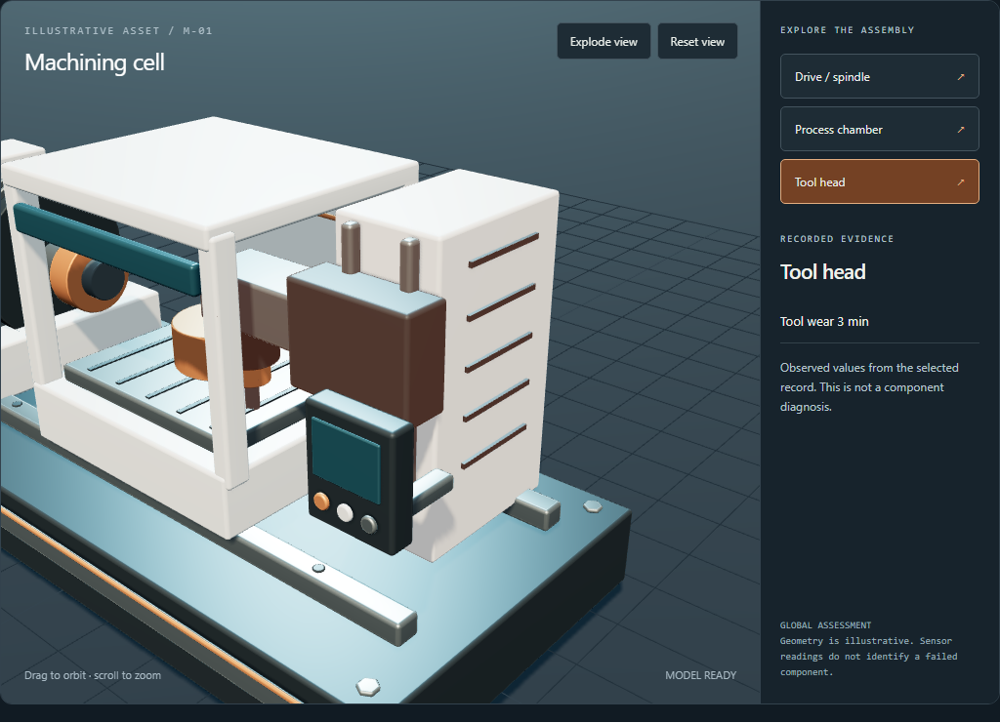

# Manufacturing maintenance demo
## Team presentation and software guide

October 23 2026 • Presentation baseline fbf09ca • FIELDWORK

Our product helps a manufacturing technician decide which machine observations need attention, inspect the evidence, and record a simulated review and proposed follow-up. It connects classification to an understandable human decision rather than treating a model score as an automatic maintenance command.

**Presentation status:** the offline demo is verified and ready to rehearse. The implemented scope includes trained classifiers, evidence selection, an original interactive 3D machine, simulated orders, persistent review notes, and proposed remediation choices. It is a hackathon decision-support demo, not a production maintenance system.

**Verification:** 93 Python tests passed. Chromium checks covered model loading, assembly selection, keyboard activation, explode/reset, reduced motion, mobile layout, a flagged order, and saving its review. Dependency checks passed. The implementation reached main through PR9. This guide reports that tested baseline; a workshop checkout must pull it before presenting.

**One sentence for the team:** “We turn a machine observation into an inspectable maintenance review, with model evidence, human judgment, and simulated actions.”



Use this guide in order: software execution, customer journey, exact demo case, presentation script, model and AWS answers, then the rehearsal checklist.

---
# Software execution from launch to score

## 1 Start the application
`app.py` starts Streamlit and exposes the separate fictional replay. Streamlit discovers `pages/1_AI4I_Baseline.py`, our main machine console. `src/ui.py` supplies the shared visual styling. Environment settings choose the explanation mode, CSV location, and local ledger. An example configuration documents settings but does not load itself.

**AWS at this step:** none in offline mode. In the workshop, the organizer environment hosts the Python process. The workshop CloudFront address is access to that environment, not our own production website deployment.

## 2 Load and validate the data
`src/ai4i.py` reads the UCI AI4I 2020 CSV: 10,000 published synthetic observations. It validates required columns, unique record IDs, feature values, and binary labels, and records a checksum. The dataset is not a continuous history of our 3D machine. Its record number is not a physical asset ID.

The model receives six inputs: product type L/M/H; air temperature in kelvin; process temperature in kelvin; rotational speed in RPM; torque in newton-metres; and tool wear in minutes. Record identifiers, machine-failure targets, and failure-mode labels are excluded from model inputs. There are five numeric measurements and one category.

## 3 Fit and select the operating policy
`fit_baseline` and `src/policy.py` use a reproducible seed-42 stratified split: 6,000 training records, 2,000 validation records, and 2,000 test records. Preprocessing and estimators fit on training data. Validation F2 chooses decision thresholds and the hybrid weight. F2 emphasizes catching failure labels more than precision. Frozen settings are then evaluated on test data.

Random forest, gradient boosting, and their weighted hybrid are selectable. The current hybrid uses 25% RF and 75% GB. It is a weighted combination, not a separately trained neural network. Streamlit caches fitted resources; training happens on a cache miss, not every assessment click. The five-model benchmark is a separate experiment.

## 4 Assess the selected observation
The user selects a policy and held-out record, then clicks Assess record. `src/ai4i.py:run_record` validates the observation and compares numeric values with training ranges. Unsupported ranges produce abstention. Otherwise the model returns a score, compared with the validation-selected threshold.

The outcomes are Below threshold, Review flagged, or Abstained. The score is uncalibrated: 0.5869 is not a verified 58.69% real-world failure probability. There is no supported future failure horizon or remaining useful life. A below-threshold result does not certify safety.

---
# Software execution from evidence to review

## 5 Construct evidence and explain it
`run_record` constructs evidence IDs and factual statements for the decision, temperatures, mechanical inputs, and wear/category. Offline mode shows these local facts. In live mode `src/bedrock.py` calls Amazon Bedrock Converse to select from the bounded evidence IDs. Bedrock does not train the classifier, change its score, or identify a replacement part.

The adapter has a configurable model ID, timeouts, bounded attempts, caching, and a process-shared paced request gate. Returned evidence IDs must be valid and include the prediction. Invalid output or service failure yields a visible factual fallback. Different teammate processes do not share that gate, so use one designated live process.

## 6 Propose and persist the simulated order
The deterministic policy in `run_record` produces a technician-review proposal for flagged or abstained observations. Below-threshold observations create no order. `src/ledger.py` validates the typed proposal and writes it transactionally to SQLite. Repeating the same assessment returns the existing order; it does not create a duplicate.

An AI4I order reserves no component or maintenance slot. The data provides no verified part/manual mapping. Model-specific identities deliberately allow separate orders for policy comparisons; this is not yet production incident deduplication across a fleet.

## 7 Render the inspection workspace
`src/policy.py:explorer_zones` groups the actual inputs into drive/spindle, process chamber, and tool head. `src/scene.py` embeds the original Blender GLB and locally bundled Three.js viewer. The editable source is `assets/machining-cell.blend`; `tools/build_machine.py` rebuilds it. `frontend/viewer/viewer.js` handles orbit, zoom, component selection, exploded view, and reset. `src/explorer.py` supplies the 2D alternative.

The geometry organizes evidence. It is not a validated digital twin or a component-level diagnosis. Changing the record or policy hides the stale result until reassessment. Ground truth appears only in an inspection panel and never reaches prediction or Bedrock.

## 8 Record a human review
`src/review.py` saves an acknowledgment, pending inspection, or completed review, together with a required note and selected proposed follow-ups. It uses a version check to reject stale concurrent edits and records review events. Completion does not certify the machine safe. The six follow-ups request inspection, inventory checking, work scope, window review, specialist support, or parts-request review; none executes an external action.

`src/notifications.py` stores a simulated notification preview through an idempotent outbox. The active console does not send email. The separate injectable SNS adapter requires explicit live authorization/configuration. SQLite is local durable storage, not a deployed shared database.

---
# The customer journey

## Who is using this
A manufacturing maintenance technician or reliability engineer reviewing a machining-cell concern. This is the strongest fit for the current data: rotational speed, torque, process temperatures, and tool wear. We are not claiming the classifier has been validated for a data center, oil platform, or arbitrary industrial fleet.

## What the user does
**Observe.** Open AI4I Baseline. Notice the synthetic-data and simulated-action labels. In this demo the user chooses a dataset observation; a future deployment would ingest supported readings from a real asset with provenance.

**Choose an operating preference.** Select Catch more failures, Fewer false alerts, or Hybrid balance. Inspect the measured recall/precision tradeoff instead of assuming a universal best model.

**Assess.** Press Assess record. Read the decision, classifier score, threshold, explanation mode, and quality warnings. A flagged observation requests attention; abstention requests review because the input is unsupported.

**Inspect.** Click Drive / spindle for RPM, torque and product type; Process chamber for air and process temperatures; Tool head for wear. Orbit or explode the assembly to orient yourself. These are recorded values, not claims that the selected component caused the alert.

**Understand.** Read evidence statements and compare the score with the threshold. Open evaluation and limitations when needed. In live mode, Bedrock selects evidence; the factual fallback remains available if inference fails.

**Review.** For an order, choose a disposition and proposed follow-up, then write a short simulation note. Save it. The review persists locally, and repeating the assessment preserves the original order identity.

**Communicate.** Preview the simulated review notification. Recording it creates an outbox record, not a delivered email. The operator can discuss a technician inspection or later parts review without representing either as executed.

## The implemented boundary
The demo ends with an inspectable assessment, a simulated review order, a persisted review disposition, and proposed next steps. It does not assign a real technician, integrate with a CMMS, verify parts stock, hire a contractor, book a real maintenance window, or collect actual post-repair evidence.

The separate fictional press replay demonstrates reservation mechanics and degraded-data handling. It does not turn the AI4I classifier into a bearing diagnosis. The isolated CRAC experiments and Pranav's separate React prototype are not the active manufacturing console.

---
# A complete rehearsable demo case

Use **Catch more failures (Random forest)** and the checked dataset. These exact results were re-run for this guide. Records 2 and 2016 are independent observations, not a before/after history of one machine.

## Case A Show a below threshold observation
Choose record **2** and click Assess record. Expected score **0.0090**, threshold **0.15**, decision **Below threshold**, and no work order. Inputs: type L; air 298.2 K; process 308.7 K; 1408 RPM; torque 46.3 Nm; tool wear 3 min.

Say: “This observation is below our selected review threshold. That is a classification result, not a safety certificate.” Click Tool head to reveal its recorded wear, then reset the view.

## Case B Show an observation requiring review
Choose record **2016**. The previous result disappears until you press Assess record. Expected score **0.5869**, threshold **0.15**, decision **Review flagged**, and a simulated technician-review order. For this exact RF recipe the order is `SIM-WO-d87fcc944429`; identifiers can change when model/data versions change.

Inputs: type L; air 298.5 K; process 308.2 K; 1301 RPM; torque 66.3 Nm; tool wear 42 min. Click Drive / spindle, then Process chamber. Show the evidence panel. Say: “These observations support inspection. They do not prove a bearing or tool has failed.”

Choose **Inspection pending**. Select **Request technician inspection** and **Draft work scope** as proposed follow-ups. Enter: “Synthetic demo case. Review the flagged observation and inspect the machine before deciding on component replacement.” Save the simulated review. Reassess record 2016 and show the saved note and same order. Do not say a technician was dispatched.

Preview the notification. If you record it, point out simulated status and that no email was sent. Switch to another policy only if time permits; reassess and discuss the displayed tradeoff rather than predicting what its score will be.

## Case C Prove the failure handling
Open the separate fictional replay. Run **normal**, then **degrading**, then **degrading** again, and finally **missing-sensor**. On a fresh ledger, degrading can reserve a fictional bearing and fixed simulated slot; the repeated assessment reuses its order. Missing data requires review. Existing resource conflicts may also require review, which is expected.

Enable **Simulate explanation-provider outage** and replay. Show factual fallback and explain that the system remains inspectable without a network call. This replay uses original JSON fixtures and deterministic rules, not the AI4I model or actual factory telemetry.

---
# A five minute presentation script

## 0 00 to 0 35 Introduce the decision
“Maintenance teams need to decide which observations deserve attention and what evidence justifies the next step. Our demo turns a machine observation into an inspectable, human-reviewed maintenance case.” Identify the technician as the user. State once, plainly, that the data is synthetic and operational actions are simulated.

## 0 35 to 1 05 Explain the flow
“We validate six inputs, apply a trained classification policy, build evidence, optionally use Bedrock to select that evidence, and record a simulated review order. The 3D machine makes the readings easier to inspect.” Do not begin with a list of AWS services. Begin with the customer's decision.

## 1 05 to 1 40 Demonstrate record 2
Select RF and record 2. Assess. Point to score and threshold, click a part, and explain no order. Keep camera movement brief. Say that the geometry is illustrative and that this is one observation.

## 1 40 to 3 00 Demonstrate record 2016
Select record 2016 and reassess. Point to Review flagged, click the mechanical zone, and read one evidence statement. Save Inspection pending with the proposed technician inspection and work-scope follow-ups. Show the persisted review and notification preview. This is the central product moment: evidence becomes an accountable proposed next step.

## 3 00 to 3 40 Explain the model tradeoff
“Random forest prioritizes catching more labels in this experiment. Gradient boosting and the hybrid offer other measured tradeoffs. Settings were chosen on validation data; the comparison remains exploratory and does not establish factory performance.” Open the actual policy-comparison panel. Do not quote overall accuracy as the main result.

## 3 40 to 4 20 Show resilience
Use the fictional missing-sensor or provider-outage case. Say: “Unsupported inputs require review; inference failure falls back to facts. We do not invent a diagnosis to complete the screen.” Mention duplicate prevention without spending a minute replaying everything.

## 4 20 to 5 00 Close with scope and next step
“Today we demonstrate observation-to-review with traceable evidence. The next deployment work is supported real-asset ingestion, calibration and validation on the target equipment, and authorized maintenance-system integration. We preserve human approval before operational action.”

**Team handoff:** one person owns the user problem and clicks; a second explains models and evidence; a third answers architecture and AWS questions. Use these as roles, not mandatory named assignments. Keep one person controlling the browser and one designated live inference process.

---
# Model and AWS questions

## Which model is best
There is no demonstrated universal winner. On the documented RF test split, precision is 39.7%, recall 88.2%, and average precision 0.686. The confusion matrix contains 60 detected failure labels, 8 missed failures, 91 false alerts, and 1841 correctly unflagged nonfailures. Those false alerts explain the need for human review.

The split is 60/20/20, stratified with seed 42. Thresholds and hybrid weights come from validation F2. The previously inspected test set makes later model comparisons exploratory. Neither a random holdout nor a high score proves performance on a different factory or future time period. Quote the current on-screen comparison for GB and hybrid; do not invent new metrics or claim the hybrid always wins.

## Where AWS actually fits
**Amazon Bedrock:** live evidence-ID selection through Converse. The classifier itself runs locally with scikit-learn. Repository workshop notes record an earlier successful live check; this UI release was verified offline. Confirm the current explanation mode before presenting live success.

**AWS identity and IAM:** the workshop's existing identity enables permitted calls. Terminal identity and an AgentCore runtime execution role are separate. This release created no roles and changed no IAM policies.

**Bedrock AgentCore:** an intended runtime integration, not a deployed or newly verified component of this release. Do not present it as hosting our current app.

**Amazon SNS:** an adapter exists behind explicit opt-in and injected configuration. The active UI records simulated messages, not real delivery. SNS acceptance would still not prove email delivery.

**S3 and CloudWatch:** sensible later integrations for approved data and deployed runtime logs; not active application storage/logging in this demo. Current data is CSV and current state is SQLite. More services are not evidence of a better product.

**CloudFront and Kiro:** CloudFront provides organizer workshop access. Kiro is developer assistance, not the inference backend. The latest UI and Blender work was developed locally and merged to GitHub.

## Common judge questions
“Is this a digital twin?” An illustrative interactive machine, not a validated physical twin. “Can you tell which part failed?” No; we group observed evidence, but the classifier predicts a dataset-level label. “When will it fail?” No validated remaining-life or time-horizon estimate. “Does it order parts?” Only proposed reviews in the AI4I path; the separate fixture replay uses fictional reservations. “What creates trust?” Input validation, evidence IDs, abstention, visible fallback, repeat prevention, and explicit human review.

---
# Rehearsal and launch checklist

## Before the team presents
Use main commit `fbf09ca` or a reviewed descendant on your own name branch. Inspect Git status before pulling; preserve teammate work. Install data and dependencies beforehand. Warm the model cache and rehearse records 2 and 2016 before the session. Keep one person controlling the demo.

**Local Windows offline launch** from the repository root:
```text
$env:DEMO_MODE='offline'
$env:DEMO_LEDGER_PATH='data/presentation.sqlite'
.venv/Scripts/python -m streamlit run app.py --server.port 8503
```
Do not start a second process on an occupied port. The verified local session was served at http://127.0.0.1:8503/AI4I_Baseline. A localhost link works only on that laptop; send teammates this PDF or the repository guide, not the localhost URL as a hosted product.

**Workshop Linux offline launch** from your own checkout:
```text
git status --short
git branch --show-current
git pull --ff-only origin yuvraj
export DEMO_MODE=offline
export DEMO_LEDGER_PATH=data/presentation.sqlite
.venv/bin/python -m streamlit run app.py --server.port 8501
```
Replace yuvraj with your own branch. Bring reviewed main updates into that branch explicitly when necessary. If setup is missing, install requirements.txt and requirements-ml.txt, then use `python -m src.ai4i --download` through the approved dataset workflow. Open the forwarded port in the workshop IDE. Stop the prior dashboard before relaunching.

## Live mode and recovery
Follow docs/workshop-usage.md using the workshop's existing identity, not copied keys. Use one designated live process, the configured allowed inference profile, and us-east-1. Confirm the accepted Bedrock explanation mode; a fallback label means that request did not complete the live evidence-selection path. The offline demo remains the fallback for expired access or throttling.

If WebGL fails, choose 2D schematic. If the dataset is missing, use the already-prepared environment or the fictional replay and clearly identify it. If a review save fails, do not claim it saved. If a simulated reservation conflicts, explain the review-required outcome; never delete shared state to make a demonstration look successful.

## Sources and follow up
Code walkthrough: docs/00-code-walkthrough.md. Current viewer: docs/3d-console.md. Teammate review: docs/pr-review-deadline.md. PR9 implementation: https://github.com/YuvrajKashyap/aws-hack26/pull/9

Dataset: Stephan Matzka, AI4I 2020, UCI, DOI 10.24432/C5HS5C, CC BY 4.0. https://archive.ics.uci.edu/dataset/601/ai4i+2020+predictive+maintenance+dataset
